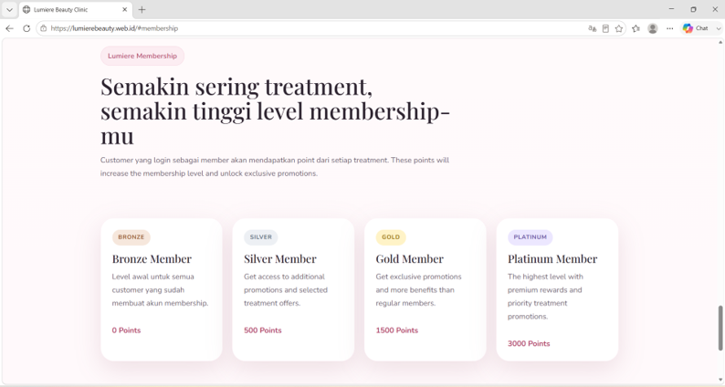
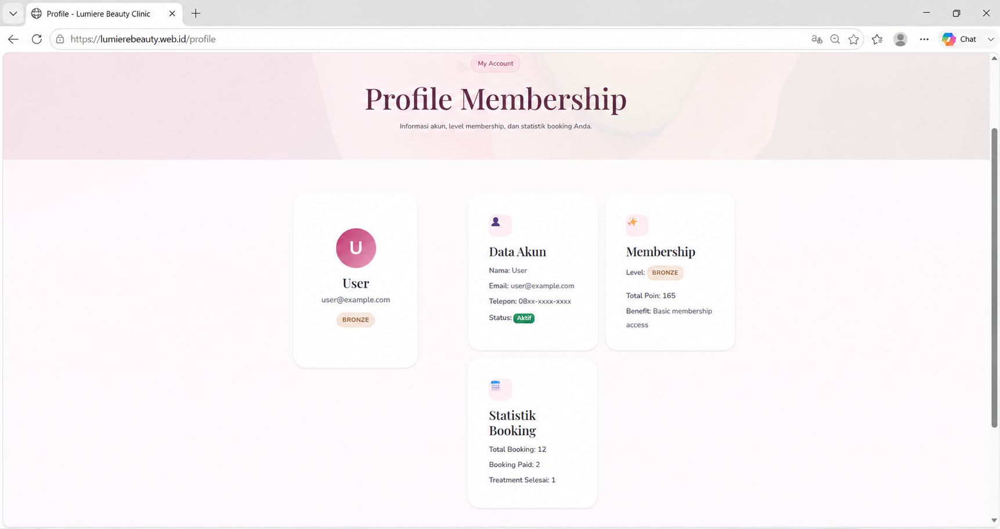

# Lumiere Beauty Clinic — Web Application

An academic group project to develop a web-based management application for a beauty clinic. The application integrates treatment information, customer bookings, payment confirmation, promotions, and a membership points system.

> **Project Context:** This is a group project. The repository contains the application source code for project context. The **My Individual Contribution** section identifies the features personally developed by Angellica Ivana.

## 1. Project Overview

Lumiere Beauty Clinic is a Laravel-based web application designed to support customer interactions and clinic operations. Customers can explore available treatments, register or log in, submit bookings, review payment instructions, and access their membership information.

Administrative users can manage selected clinic operations through an admin area.

## 2. Application Screenshots

### Homepage — Membership Levels



The homepage displays four membership tiers: Bronze, Silver, Gold, and Platinum, including their respective point thresholds and benefit descriptions.

### Customer Profile — Membership Information



The profile page presents customer account information, membership level, accumulated points, and booking statistics. Personal information in this screenshot has been replaced with generic sample data.

## 3. Key Features

- Customer registration, login, and account access.
- Treatment catalogue and treatment booking flow.
- Payment instructions and payment confirmation workflow.
- Admin-side booking status management.
- Promotion listing and management.
- Homepage membership tier information.
- Customer My Points page with current membership level and point transaction history.
- Membership point calculation and membership-level synchronization.

## 4. My Individual Contribution — Membership Module

I was responsible for developing the membership-related components of the group application.

### 4.1 Homepage Membership Section

- Developed the membership section displayed on the homepage.
- Presented four membership tiers: Bronze, Silver, Gold, and Platinum.
- Displayed membership point thresholds and benefit descriptions for each tier.

### 4.2 My Points Page

- Developed the customer-facing My Points page.
- Displayed the customer's current membership level and accumulated points.
- Implemented paginated point transaction history.

### 4.3 Backend Membership Functionality

- Implemented membership point calculation and point transaction recording.
- Integrated point awarding with the booking payment status flow.
- Added duplicate-award prevention to ensure the same booking does not generate multiple earning transactions.
- Implemented point expiry handling.
- Developed membership-level synchronization based on the customer's active point balance.

## 5. Membership Rules and Business Logic

The application implements the following membership thresholds:

| Membership Level | Minimum Points |
|---|---:|
| Bronze | 0 |
| Silver | 500 |
| Gold | 1,500 |
| Platinum | 3,000 |

**Membership Point Calculation:**

- Points are awarded when a booking's payment status is updated to `paid`.
- The point calculation in `MembershipService` uses `floor(total_price / 10,000)`, with a minimum of 1 point.
- Earned points are assigned an expiry date one year after the earning date.
- Membership levels are synchronized based on the customer's active point balance.

## 6. Technology Stack

| Category | Technology |
|---|---|
| Backend | PHP 8.1+, Laravel 10 |
| Database | MySQL |
| Frontend | Laravel Blade, HTML, CSS, JavaScript |
| Dependency Management | Composer, npm |
| Build Tool | Vite |

## 7. Relevant Source Files

| Component | Source File |
|---|---|
| Homepage Membership Section | `resources/views/home.blade.php` |
| My Points Page | `resources/views/points/index.blade.php` |
| My Points Controller | `app/Http/Controllers/PointController.php` |
| Membership Business Logic | `app/Services/MembershipService.php` |
| Membership Model | `app/Models/MembershipLevel.php` |
| Point Transaction Model | `app/Models/PointTransaction.php` |
| User Membership Relationship | `app/Models/User.php` |
| Membership Database Structure | `database/migrations/` |
| Membership Tier Seed Data | `database/seeders/MembershipLevelSeeder.php` |
| Booking-to-Points Integration | `app/Http/Controllers/Admin/BookingController.php` |

## 8. Project Structure

```text
lumiere-beauty-membership-system/
│
├── app/
│   ├── Http/Controllers/
│   ├── Models/
│   └── Services/
│
├── bootstrap/
├── config/
├── database/
│   ├── migrations/
│   └── seeders/
│
├── public/
├── resources/
│   └── views/
│
├── routes/
├── screenshots/
├── tests/
│
├── README.md
├── composer.json
└── package.json
```

## 9. Installation Guide

### Requirements

- PHP 8.1 or later
- Composer
- MySQL
- Node.js and npm

### Installation Steps

**1. Clone the repository**

```bash
git clone https://github.com/angellica24/lumiere-beauty-membership-system.git

cd lumiere-beauty-membership-system
```

**2. Install PHP dependencies**

```bash
composer install
```

**3. Create the environment file**

For Windows PowerShell:

```powershell
Copy-Item .env.example .env
```

For macOS/Linux:

```bash
cp .env.example .env
```

**4. Configure the database**

Create a MySQL database, for example `lumiere_beauty`, and update the database settings in the `.env` file.

**5. Generate the application key**

```bash
php artisan key:generate
```

**6. Configure an optional local admin account**

Before running the seeders, configure the following values in `.env` if an admin account is required:

```dotenv
LUMIERE_ADMIN_NAME="Lumiere Admin"
LUMIERE_ADMIN_EMAIL=your-admin-email@example.com
LUMIERE_ADMIN_PHONE=
LUMIERE_ADMIN_PASSWORD=use-a-strong-local-password
```

The admin seeder is skipped if the email or password is not configured.

**7. Run database migrations and seeders**

```bash
php artisan migrate --seed
```

**8. Install and build frontend dependencies**

```bash
npm install

npm run build
```

**9. Start the development server**

```bash
php artisan serve
```

Open the local URL provided by Artisan, usually:

`http://127.0.0.1:8000`

## 10. Demo and Security Notes

- This repository is intended for academic demonstration and portfolio review, not production deployment.
- The QRIS image and bank/e-wallet details included in the application are demo placeholders for payment-flow simulation only.
- The repository does not include the actual `.env` file, application key, runtime logs, session data, compiled cache, or old SQL dump.
- Configure local credentials in your own `.env` file.
- Never commit passwords, API keys, database credentials, customer data, or actual payment credentials.
- As this is a group project, agreement from the project team should be obtained before publicly distributing the full source code.

## 11. Project Status

**Status:** Academic Group Project — Completed Development for Demonstration.

The project demonstrates the implementation of a web-based beauty clinic management application, with particular emphasis on membership management, point calculation, transaction recording, and membership-level synchronization.

The **My Individual Contribution** section documents the specific membership-related components personally developed by Angellica Ivana.
